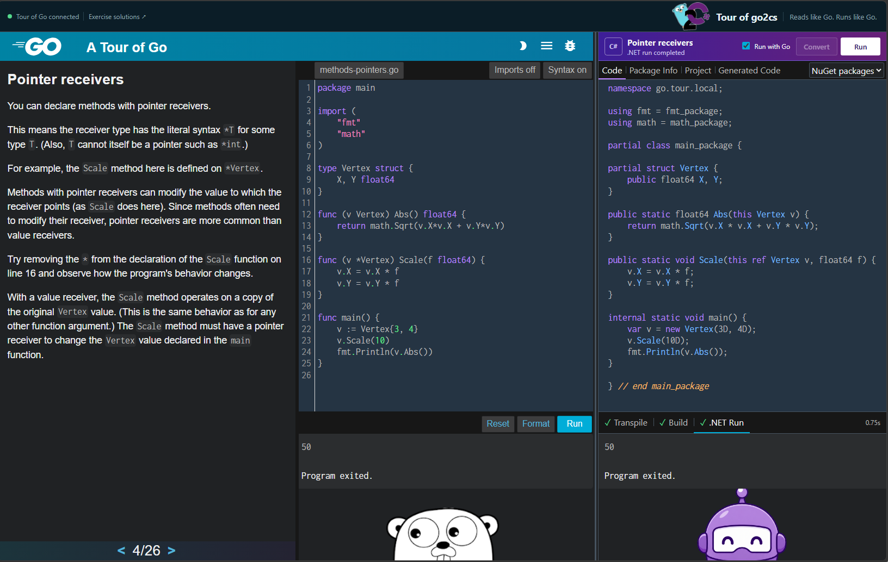
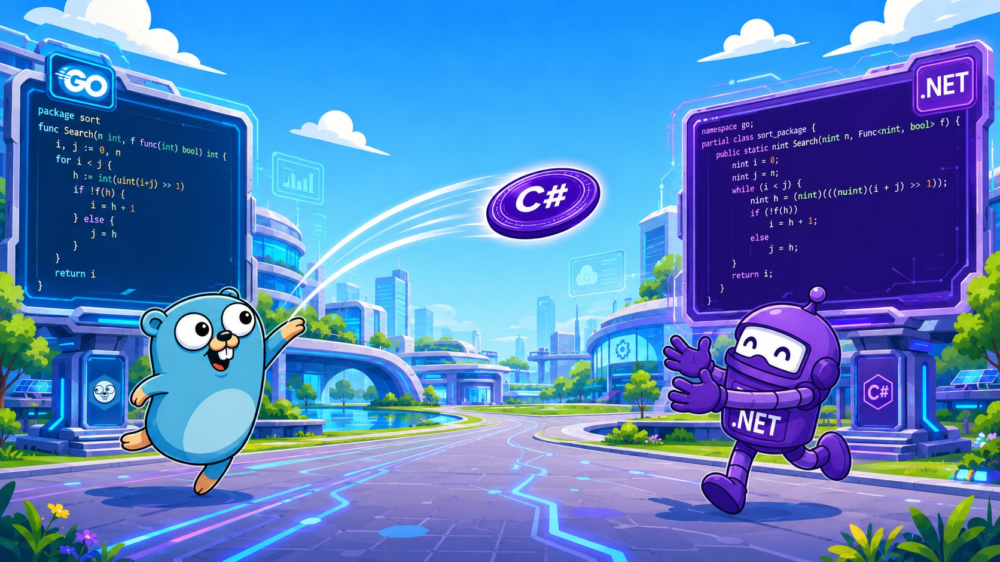

# go2cs — Go to C# Converter

[](https://www.nuget.org/packages/go.lib) [](https://www.nuget.org/packages/go2cs)

Browse all: [Go Standard Library NuGet packages](https://www.nuget.org/packages?q=go2cs%20ritchiecarroll) · [Converted Go module NuGet packages](https://www.nuget.org/packages?q=nugetgo)

Go module to NuGet package registry: [nugetgo.net](https://nugetgo.net)
> Used during `go2cs -recurse=nuget` so an already converted dependency is restored as a package instead of converted again ([how](ConvertingAModule.md#mapping-modules-to-nuget-packages)).

---

**go2cs converts Go source code into C# that reads like the Go it came from and behaves the same.**
A Go developer can read the converted code and follow it, and a .NET developer can use a Go library as
ordinary managed code. Go's slices, maps, channels, goroutines, `defer`, multiple returns, struct
embedding and interfaces come from a small runtime library and compile-time source generators, so that
machinery stays out of the converted files. Behavior comes first: goroutines, channels, `select` and
`defer` keep Go's semantics. The converted Go standard library passes Go's own tests, package by package,
on Windows, on Linux (x64 and Arm64) and on macOS (Intel and Apple silicon); the
[roster](ValidatedTestPackages.md) has each package's counts.
<!-- Parity, read at the roster for 1.26.11.1 (2026-11-15, seat 1 of the user-facing docs audit): every row carries a Windows
     reading; every row but the two Windows-only ones (internal/syscall/windows and its registry child) carries a linux-arm64
     reading and a darwin reading, each chip shown where Intel and Apple silicon differ. -->

## 📰 NEWS — Go 1.26.11, cgo conversion, linux-arm64 packages, and TypeScript's compiler and SQLite in C#

<!-- HELD for release day with the NEWS.md entry (the .2 and .3 precedent): "November XX" and the anchor's "november-xx"
     both become the publish date as the last change before the release tag. This block quotes no roster figure
     (check-roster-format 2e). Written by the 1.26.11.1 release-controls batch (claude/p4-release-controls-12611). -->
**November 19, 2026, NuGet 1.26.11.1.** The fourth release on the Go 1.26 line, converted from Go 1.26.11, a patch
release with security fixes. `go2cs -cgo` converts a package that calls C, the packages ship a linux-arm64 build,
Microsoft's TypeScript compiler, written in Go, converts, compiles and type-checks
([typescript-go-cs](https://github.com/ritchiecarroll/typescript-go-cs)), and a modernc.org/sqlite program that writes
and reads a database file prints exactly what native Go prints, on Windows and on Linux
([sqlite-cs](https://github.com/ritchiecarroll/sqlite-cs)). Each Go method
now lives in a class of its type's own, so assemblies built against 1.26.10.3 must be rebuilt, and the build now says
so by name instead of failing at run time.
[Full announcement](NEWS.md#november-19-2026--go-12611-cgo-conversion-linux-arm64-packages-and-typescripts-compiler-and-sqlite-in-c).

**➡ All announcements can be found in the [go2cs News Archive](NEWS.md).**

## Example

Given this Go:

```go
type Person struct {
    name string
    age  int32
}

func (p Person) IsAdult() bool {
    return p.age >= 18
}
```

go2cs produces this C#:

<!-- source: src/tests/Behavioral/StructPromotion/StructPromotion.cs.target:8-11 and :17-19 -->
```csharp
partial struct Person {
    internal @string name;
    internal int32 age;
}
…
public static bool IsAdult(this Person p) {
    return p.age >= 18;
}
```

## Real standard-library conversions, side by side

The goal — *reads like Go* — is easiest to judge on real code. Below are converted standard-library files
next to their original **Go 1.26.11** source, in order of increasing richness:

| Package | Go 1.26.11 source | Converted C# | What it shows |
|:--|:--|:--|:--|
| `errors` | [errors.go](https://github.com/golang/go/blob/go1.26.11/src/errors/errors.go) | [errors.cs](https://github.com/ritchiecarroll/go2cs/blob/master/src/core/errors/errors.cs) | Error values and an unexported type satisfying the `error` interface. |
| `cmp` | [cmp.go](https://github.com/golang/go/blob/go1.26.11/src/cmp/cmp.go) | [cmp.cs](https://github.com/ritchiecarroll/go2cs/blob/master/src/core/cmp/cmp.cs) | Generics with an ordered-type constraint. |
| `unicode/utf8` | [utf8.go](https://github.com/golang/go/blob/go1.26.11/src/unicode/utf8/utf8.go) | [utf8.cs](https://github.com/ritchiecarroll/go2cs/blob/master/src/core/unicode/utf8/utf8.cs) | Constants keeping Go's hex/binary literal formatting; arrays and structs. |
| `sort` | [search.go](https://github.com/golang/go/blob/go1.26.11/src/sort/search.go) | [search.cs](https://github.com/ritchiecarroll/go2cs/blob/master/src/core/sort/search.cs) | Binary search driven by a `func(int) bool` closure. |
| `strings` | [reader.go](https://github.com/golang/go/blob/go1.26.11/src/strings/reader.go) | [reader.cs](https://github.com/ritchiecarroll/go2cs/blob/master/src/core/strings/reader.cs) | A struct with receiver methods, tuple returns, and interface implementation. |
| `container/list` | [list.go](https://github.com/golang/go/blob/go1.26.11/src/container/list/list.go) | [list.cs](https://github.com/ritchiecarroll/go2cs/blob/master/src/core/container/list/list.cs) | A doubly-linked list — pointers and receiver methods. |

Browse the whole set under [`src/core`](https://github.com/ritchiecarroll/go2cs/tree/master/src/core).

## Explore

* Go and C# side by side: [Tour of go2cs](https://github.com/ritchiecarroll/go2cs/blob/master/src/tour/README.md)
* Real converted code: [the Go standard library](https://github.com/ritchiecarroll/go2cs/tree/master/src/core)
* How Go constructs map to C#: [Conversion Strategies](ConversionStrategies.md)
* What the converter does: [Features](Features.md) &rarr; [Current Go feature support](GoFeatureSupport.md)
* Call converted Go from C#: [Consuming converted Go](ConsumingGoFromCSharp.md)
* What stays stable for C# code: [The public surface](PublicSurface.md)
* Passing Go's own tests: [Validated Test Packages](ValidatedTestPackages.md) / [Validated Modules](ValidatedModules.md)
* Before you start: [Limitations](Limitations.md) and [Known issues](KnownIssues.md)
* Where it stands: [Status](#status) and the [Roadmap](Roadmap.md)
* Build it yourself: [Building go2cs from source](BuildingGo2cs.md)

[](images/tour-of-go2cs.png)

## Requirements

- **[.NET 10.0 SDK](https://dotnet.microsoft.com/download)**, to build and run the converted C#. A newer .NET SDK
  builds it too, and on a machine with no .NET 10 runtime a converted program runs on the newer one. The go.*
  packages are validated on .NET 10; set `RollForward` to `Disable` or `LatestMinor` in your project to require .NET 10.
  <!-- 2026-11-20, i9: go.lib's buildTransitive targets give an executable RollForward=Major (src/tests/PackageTests/RollForward;
       docs/phase4/DATA-net11-sdk-usability.md). P3's review asked for this sentence: the change turns the launch refusal into a
       run on a runtime the corpus is not validated on. -->

- **No Go installation, with the go2cs dotnet tool.** The converter uses the Go toolchain to load and
  type-check the source it converts, so that source must already build with `go build`. The
  [dotnet tool](DotnetTool.md) downloads the Go release it converts with, Go 1.26.11, on first use.
  To build the converter from source instead, you need [Go 1.26.11](https://go.dev/dl/) or later. The standard
  library packages are converted from, and validated on, Go 1.26.11, and the
  [Roadmap](Roadmap.md#go-releases) says which Go releases come next.
- **Windows (x64), Linux (x64 or Arm64) or macOS (Intel or Apple silicon)**, where the converted
  standard library is validated against Go's own tests ([roster](ValidatedTestPackages.md),
  [Platforms](Roadmap.md#platforms)).
  A minimal Linux, such as a container or a fresh server, also needs `git` and `curl`, and .NET's
  native dependencies ICU and OpenSSL
  ([Microsoft's list](https://learn.microsoft.com/dotnet/core/install/linux-scripted-manual#dependencies)).

## Installing the converter

Install it as a .NET tool:

```shell
dotnet tool install -g go2cs
```

The tool is the converter itself, built for Windows, Linux and macOS on x64 and Arm64, and it needs no Go: the
first conversion downloads the Go release go2cs converts with, checks it against hashes built into go2cs, and
keeps it in your user cache folder. [The go2cs dotnet tool](DotnetTool.md) explains where that Go comes from,
how to install it from a file on a machine with no network access, and `go2cs toolchain`.

### Building it from source

Clone the repository and install the converter from the clone. `go install` puts the `go2cs` binary in
`GOBIN` (or `GOPATH/bin`), which a standard Go setup already has on its `PATH`:

```shell
git clone https://github.com/ritchiecarroll/go2cs.git
cd go2cs/src/go2cs
go install .
```

[Building go2cs from source](BuildingGo2cs.md) has the rest: cross-compiling, running the tests and the
layout of the repository.

## Usage

```shell
go2cs [options] <input_dir> [output_dir]
```

```shell
# a module and its dependencies; the standard library comes from NuGet:
go2cs -recurse=nuget module_dir out

# only the module's own packages:
go2cs -recurse=module,nuget module_dir out

# one package; it builds against a go2cs clone: dotnet build -p:go2csPath=<go2cs>/src/:
go2cs package_dir out

# convert for another operating system:
go2cs -platforms linux/amd64 -recurse=nuget module_dir out-linux

# convert a module, run its tests, compare with go test:
go2cs -tests -recurse -go2cspath <go2cs>/src -test-action all module_dir out

# which release this converter belongs to:
go2cs -version
```

Give the output directory when you convert a package: without it, the C# is written beside the Go input.

| Option | What it does |
|:--|:--|
| `-recurse=nuget` | Convert a module and its third-party dependencies, in dependency order; a dependency already published as a converted NuGet package is referenced instead of converted. The standard library, the runtime and the source generators are NuGet package references, so nothing is staged on your machine. Start here. |
| `-recurse="module, nuget"` | Convert only the module's own packages, and reference the dependencies without converting them. Use it when a dependency does not convert yet; the solution builds once the dependencies are in place. |
| `-tests` | Also convert the Go test suite. With `-test-action all`, build it, run it, and compare its results with `go test`. For a module it takes plain `-recurse`, not `=nuget` or `=module`, and `-go2cspath` with the absolute path of a go2cs clone's `src` folder, whose converted standard library the tests build against. |
| `-platforms <os/arch>` | The platform to convert for. It defaults to the machine you are on. |
| `-tags <list>` | The build tags to select files with, as in `go build -tags`. |
| `-comments` | Carry the Go comments into the C#. |
| `-version` | Print the release this converter belongs to, and convert nothing. |

[Command-line options](CommandLine.md) lists every option and more examples, and
[diagnostic codes](DiagnosticCodes.md) lists every `GO2CS` code the converter and the C# build can report.

## Converting a real-world module

Four steps take a Go program with third-party dependencies to a running .NET program:

1. **Start from Go that builds.** Set `GOTOOLCHAIN=local`, so Go uses the release you installed, and
   run `go build ./...` in your module. A dependency that needs a newer Go has to be pinned to an older
   release first.
2. **Convert it.** In the module's directory, `go2cs -recurse=nuget . csharp` writes the C# for your
   packages and for every dependency under `csharp/`, and leaves the Go untouched.
3. **Build it.** Each converted project has a solution beside it. In `csharp/src/<import-path>`, run
   `dotnet build` on the `.slnx` file there, or open it in Visual Studio.
4. **Run it.** `dotnet run`, from the same folder.

**[Converting a real-world Go module](ConvertingAModule.md)** does all four with a real program and
shows the output. It also covers build tags, converting your own packages before their dependencies,
building against a local copy of the standard library, and using modules that are already published as
NuGet packages. Wondering which Go modules make good conversions? The
[go2cs Target Atlas](https://go2cs.net/TargetAtlas.html) ranks the most-depended-on ones.

## Frequently asked questions

* **Why convert Go to C#?** [To use Go code inside .NET](FAQ.md#why-convert-go-to-c).
* **Is it slower than Go?** [Usually, and sometimes not](FAQ.md#is-converted-code-slower-than-go).
* **Does it behave like Go?** [Measured against Go's own tests](FAQ.md#does-converted-code-really-behave-like-go).
* **Did AI write this?** [Not the foundation, but AI closed the gap](FAQ.md#did-ai-write-this).
* **What does not convert?** [Parts of cgo, assembly, newer Go](FAQ.md#what-does-not-convert).
* **What does the C# look like?** [Like the Go](FAQ.md#what-does-the-generated-c-look-like). [See examples](#real-standard-library-conversions-side-by-side).
* **How do I call it from C#?** [Like any other library](FAQ.md#how-do-i-call-a-converted-go-package-from-c).
* **Why not a native library?** [You can; here is the trade](FAQ.md#why-not-call-go-through-a-native-library-instead).
* **Third-party dependencies?** [Yes, not all convert cleanly yet](FAQ.md#can-it-convert-a-module-with-third-party-dependencies).
* **Does it work with Native AOT?** [Yes, at a cost in time and size](FAQ.md#does-it-work-with-native-aot).
* **What license covers the output?** [Not the converter's](FAQ.md#what-license-covers-the-code-go2cs-generates).

[More questions](FAQ.md): versions, platforms, dependencies, C# to Go.



## Status

The whole Go standard library converts and compiles as .NET assemblies, and every package that can be
validated matches its own Go test suite in C#, verdict for verdict, with every difference disclosed, on
Windows (x64), on Linux (x64 and Arm64) and on macOS (Intel and Apple silicon).
[Validated Test Packages](ValidatedTestPackages.md) carries the current counts, package by package, and
the [Roadmap](Roadmap.md) says where the project stands and what comes next.

### Try it yourself — validate a converted test suite

You do not have to take the roster's word for it. One command converts a package's Go tests, runs them
in C#, runs `go test`, and compares the two:
[Validate a converted test suite](BuildingGo2cs.md#validate-a-converted-test-suite).

## Contributing

Start with [`CONTRIBUTING.md`](https://github.com/ritchiecarroll/go2cs/blob/master/CONTRIBUTING.md), then
[Building go2cs from source](BuildingGo2cs.md) and [`Architecture.md`](Architecture.md). There is plenty
of low-hanging fruit here; jump in if you'd like to help.

go2cs is a personal project, worked on in spare time. Issues, ideas and pull requests are welcome and are read,
but replies are best-effort and can take a while. Questions belong in
[Discussions](https://github.com/ritchiecarroll/go2cs/discussions), and defects in
[Issues](https://github.com/ritchiecarroll/go2cs/issues/new/choose).
<!-- Launch plan decision D9: wording OK'd by the owner 2026-10-12 for his later edit. -->

## License

go2cs contains components under several licenses. The converter (`src/go2cs`) is
licensed under **AGPL-3.0-only** with the [go2cs Converter Output Exception](https://github.com/ritchiecarroll/go2cs/blob/master/src/go2cs/LICENSE-EXCEPTION),
an additional permission under AGPL section 7. Alternative commercial licensing for
the converter is available from the copyright holder listed in
[AUTHORS](https://github.com/ritchiecarroll/go2cs/blob/master/AUTHORS), at the contact
address given there. Original runtime/support libraries and Roslyn
generators use **MIT**. Standard-library packages, including project-owned
handwritten additions, use **BSD-3-Clause**, with upstream notices preserved.

Code generated by go2cs is not subject to the converter's AGPL license merely because
it was produced by go2cs, and the output exception says so as a binding term: rights
in output remain governed by the input source and any separately licensed components
incorporated into or referenced by the output, and the project scaffolding the
converter emits into your output is MIT. Running the converter, locally or in your
own build, triggers no AGPL obligation; only distributing the converter, or offering
a modified converter to others over a network, does.

**Commercial licensing, sponsorship and acquisition.** go2cs is developed by a single
maintainer and will stay free for its users. A company that wants to ship the
converter inside a proprietary product, offer it as a service without publishing its
changes, or take on the project's long-term development is welcome to talk: a
commercial license, sponsorship of ongoing work, or an outright
acquisition that keeps the tool free for the community are all on the table. The
contact address is in [AUTHORS](https://github.com/ritchiecarroll/go2cs/blob/master/AUTHORS).
Contributions to the converter carry a Developer Certificate of Origin sign-off and a
relicensing grant, see [CONTRIBUTING.md](https://github.com/ritchiecarroll/go2cs/blob/master/CONTRIBUTING.md),
which is what keeps those options open. The go2cs name and logo identify this
project; a fork is welcome under the AGPL but should carry its own name.

See [LICENSING.md](https://github.com/ritchiecarroll/go2cs/blob/master/LICENSING.md) for the component matrix, exceptions and output
policy, and [NOTICE](https://github.com/ritchiecarroll/go2cs/blob/master/NOTICE) for attribution.
